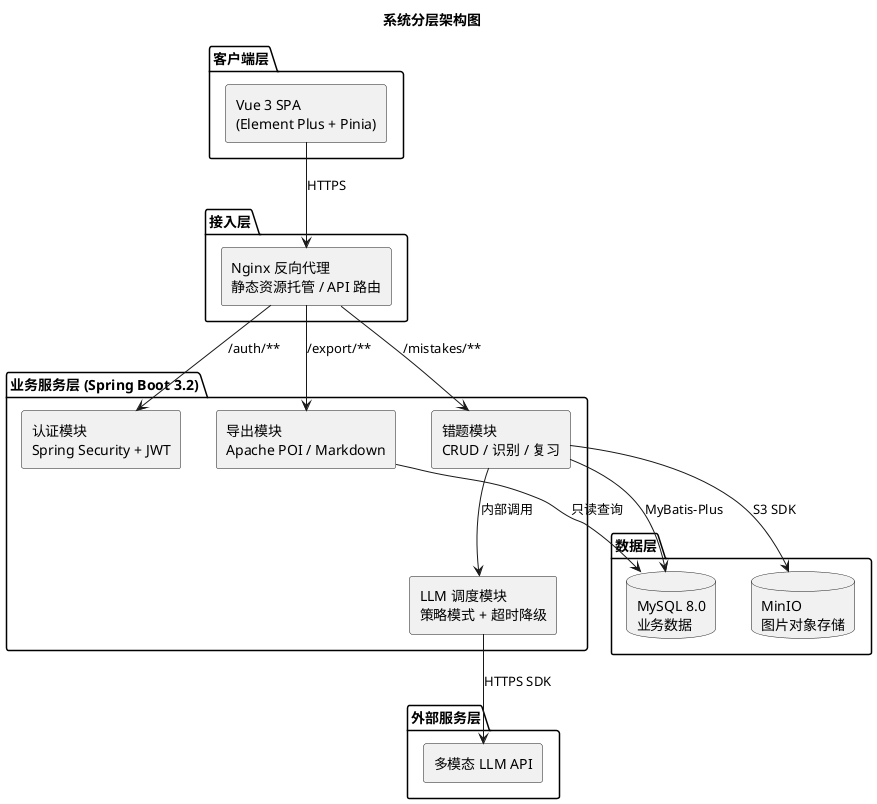
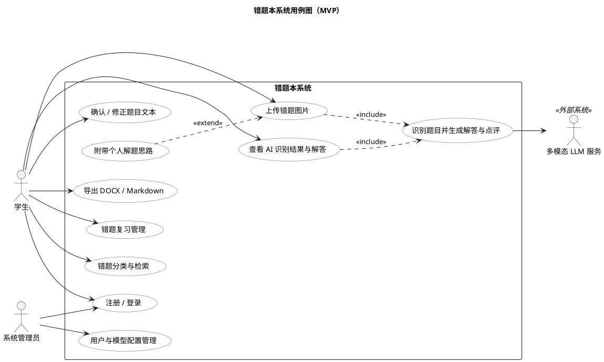
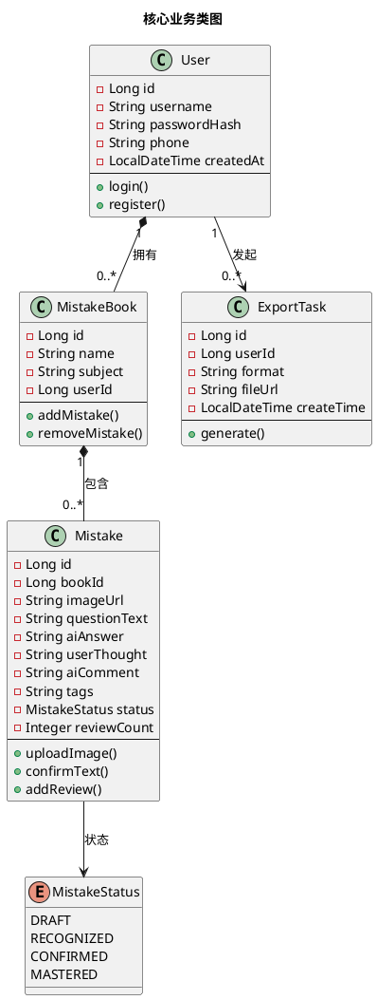
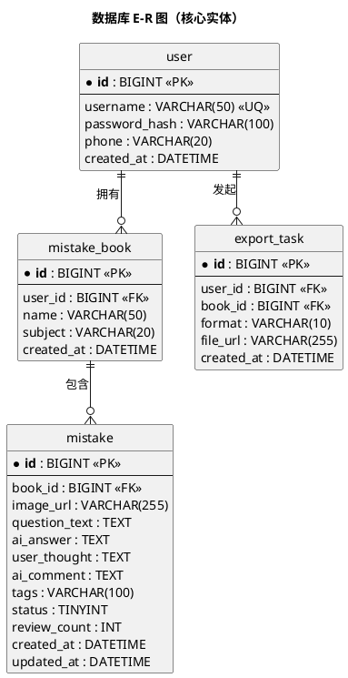
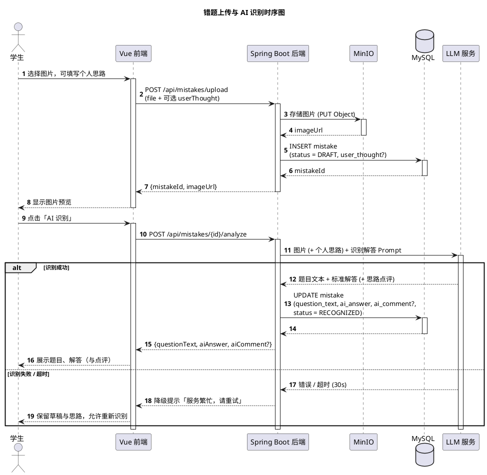
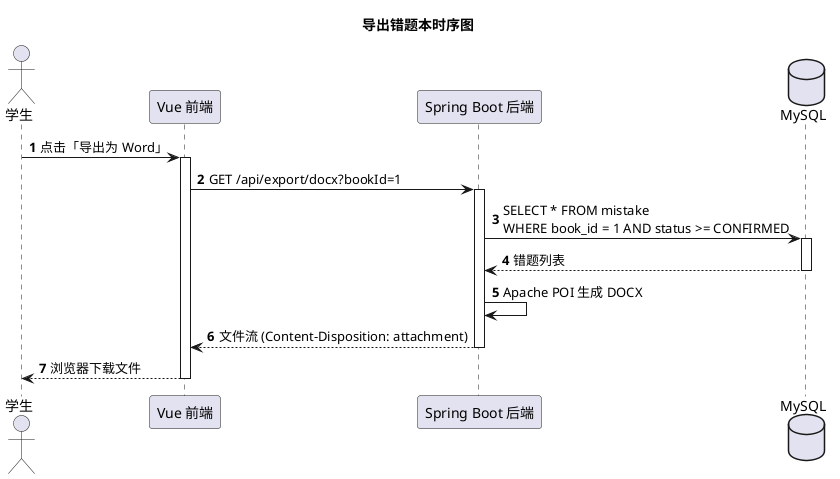
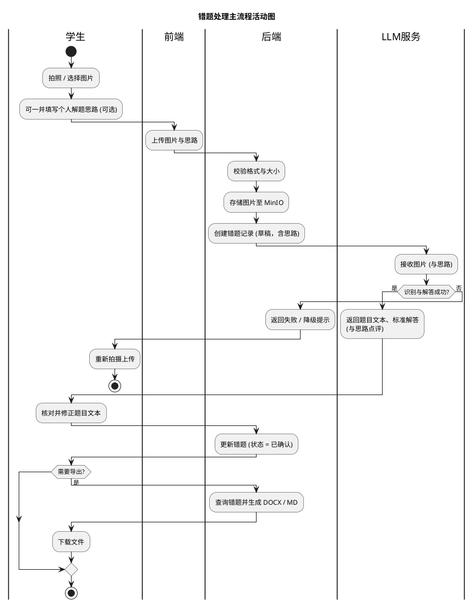
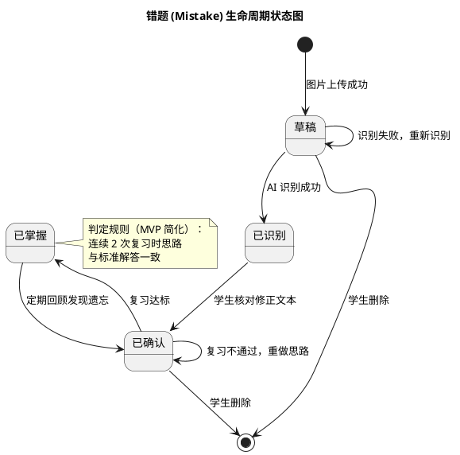
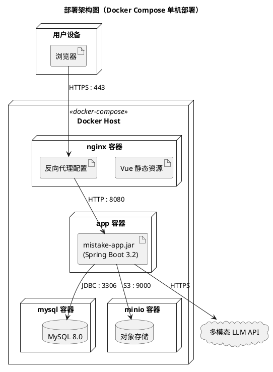

# 错题本软件系统分析与设计说明书（MVP 版）

> 技术栈：**Vue 3 + Spring Boot 3**
> 建模工具：**PlantUML**
> 文档范围：需求建模、静态结构、动态行为、接口定义及部署架构

---

## 1. 文档概述

### 1.1 编写目的

本文档旨在为"AI 智能错题本"系统提供完整的分析与设计方案，作为后续开发、测试与验收的依据。

### 1.2 项目范围

构建一个支持拍照上传、LLM 自动识别与解答、个人思路记录、错题复习与多格式导出的 Web 应用 MVP 版本。

### 1.3 用户角色

| 角色                             | 说明                           |
| :------------------------------- | :----------------------------- |
| **学生（核心用户）**       | 拍照上传、整理错题、复习、导出 |
| **系统管理员（MVP 预留）** | 用户管理、LLM 模型配置         |

### 1.4 术语与缩写

| 术语  | 说明                                        |
| :---- | :------------------------------------------ |
| MVP   | Minimum Viable Product，最小可行产品        |
| LLM   | Large Language Model，大语言模型            |
| OCR   | Optical Character Recognition，光学字符识别 |
| MinIO | 兼容 S3 协议的开源对象存储                  |

---

## 2. 系统架构设计

### 2.1 架构模式

采用**前后端分离**架构，整体分为五层：客户端层、接入层、业务服务层、外部服务层、数据层。前端只与 Nginx 交互，后端模块间通过内部调用解耦，LLM 调度模块对外部模型做统一抽象，便于切换主备模型。

**设计说明**：导出模块只负责查询数据并生成文件流，文件经 Nginx 返回给客户端下载，不直接与前端组件交互；LLM 调度模块是唯一访问外部模型的出口，便于统一做超时控制与降级。

### 2.2 技术栈明细

| 层级           | 技术选型                  | 说明         |
| :------------- | :------------------------ | :----------- |
| **前端** | Vue 3 + TypeScript + Vite | 组合式 API   |
|                | Element Plus              | UI 组件库    |
|                | Axios                     | 异步请求     |
|                | Pinia                     | 状态管理     |
| **后端** | Spring Boot 3.2           | 基础框架     |
|                | Spring Security + JWT     | 安全认证     |
|                | Spring AI / RestTemplate  | LLM 接口抽象 |
|                | MyBatis-Plus              | 数据持久化   |
|                | Apache POI                | DOCX 导出    |
| **存储** | MySQL 8.0                 | 业务数据     |
|                | MinIO                     | 图片文件存储 |
| **部署** | Docker + Docker Compose   | 容器化编排   |

---

## 3. 需求分析

### 3.1 用例图

**设计说明**：「附带个人解题思路」是「上传错题图片」的 `<<extend>>` 扩展用例——学生可以在上传图片时一并写下自己的解题思路，也可以不传。后端接入**多模态 LLM**，一次调用即可"看图完成识别 + 解答"：将图片（及学生思路，若有）直接发给模型，一次性返回题目文本、标准解答（与思路点评），无需单独的 OCR 环节。该内部子用例「识别题目并生成解答与点评」是学生不可见、由系统触发的服务能力，因此 LLM 作为辅助参与者（secondary actor）放在系统边界右侧。管理员相关用例在 MVP 中仅做接口预留。

### 3.2 核心用例规约：拍照上传并识别

| 项目               | 内容                                                                                                                                                                                                                                                                                                                                                          |
| :----------------- | :------------------------------------------------------------------------------------------------------------------------------------------------------------------------------------------------------------------------------------------------------------------------------------------------------------------------------------------------------------ |
| **用例编号** | UC-02                                                                                                                                                                                                                                                                                                                                                         |
| **用例名称** | 上传错题图片并完成 AI 识别                                                                                                                                                                                                                                                                                                                                    |
| **参与者**   | 学生（主参与者）、多模态 LLM 服务（辅助参与者）                                                                                                                                                                                                                                                                                                               |
| **前置条件** | 学生已登录，持有有效 JWT                                                                                                                                                                                                                                                                                                                                      |
| **后置条件** | 错题记录创建成功，状态为「已识别」，题目文本与标准解答已入库；若上传时附带了个人思路，思路与点评一并入库                                                                                                                                                                                                                                                      |
| **主事件流** | 1. 学生选择图片，可一并填写个人解题思路（可选），点击上传2. 系统校验格式与大小，将图片存入 MinIO3. 系统创建错题记录（状态 = 草稿，含个人思路），返回 mistakeId 与图片预览4. 学生确认发起识别5. 系统将图片（及个人思路，若有）发给多模态 LLM，一次调用返回题目文本、标准解答（与思路点评）6. 系统更新错题记录（状态 = 已识别），向学生展示题目、解答（与点评） |
| **扩展流**   | 1a. 学生未填写思路：步骤 5 仅返回题目文本与标准解答3a. 图片格式非法或超过 10MB：拒绝上传并提示5a. 图片模糊导致识别置信度过低：提示重新拍摄上传5b. LLM 调用超时（>30s）：返回降级提示「服务繁忙，请稍后重试」，状态保持草稿，图片与思路不丢失                                                                                                                  |
| **业务规则** | 单次仅识别一张图片；识别结果须经学生确认后才进入「已确认」状态                                                                                                                                                                                                                                                                                                |

### 3.3 其余核心用例简述

| 用例名称                       | 前置条件                     | 主事件流                                                                             | 异常流                         |
| :----------------------------- | :--------------------------- | :----------------------------------------------------------------------------------- | :----------------------------- |
| **错题复习管理**         | 错题已进入「已确认」状态     | 1. 学生进入复习列表2. 系统按遗忘曲线 / 复习次数排序展示错题3. 学生回顾并标记掌握情况 | 无待复习错题：提示"已全部掌握" |
| **导出 DOCX / Markdown** | 错题本内至少有一条已确认错题 | 1. 学生选择错题本与导出格式2. 系统查询错题列表并生成文件3. 返回文件流供下载          | 无错题可导出：提示先整理错题   |

---

## 4. 数据模型设计

### 4.1 类图

**设计说明**：密码字段存储哈希值（`passwordHash`），不落明文；`status` 由裸 `Integer` 改为枚举，取值语义见 5.4 状态图；错题本与错题之间是组合关系（删除错题本则其下错题一并删除）。

### 4.2 数据库物理模型

E-R 图（核心实体）：

**mistake 表字段说明：**

| 字段名        | 类型         | 说明                                 |
| :------------ | :----------- | :----------------------------------- |
| id            | BIGINT PK    | 错题 ID，雪花算法生成                |
| book_id       | BIGINT FK    | 所属错题本 ID（建索引）              |
| image_url     | VARCHAR(255) | MinIO 对象存储路径                   |
| question_text | TEXT         | OCR 识别并经学生确认的题目           |
| ai_answer     | TEXT         | LLM 生成的标准解答                   |
| user_thought  | TEXT         | 学生个人思路                         |
| ai_comment    | TEXT         | LLM 对学生思路的点评                 |
| tags          | VARCHAR(100) | 标签，逗号分隔（如：数学,函数）      |
| status        | TINYINT      | 0-草稿，1-已识别，2-已确认，3-已掌握 |
| review_count  | INT          | 复习次数，默认 0                     |
| created_at    | DATETIME     | 创建时间                             |
| updated_at    | DATETIME     | 更新时间                             |

**索引设计**：`mistake(book_id, status)` 联合索引支撑"按错题本 + 状态筛选"的高频查询；`user(username)` 唯一索引。

---

## 5. 动态行为设计

### 5.1 时序图：错题上传与识别

### 5.2 时序图：导出错题本

### 5.3 活动图：错题处理主流程

### 5.4 状态图：错题生命周期

---

## 6. 接口设计（RESTful）

统一响应格式：`{ "code": 0, "message": "ok", "data": {...} }`，除登录/注册外均需携带 `Authorization: Bearer <token>`。

| 模块 | 方法   | 端点                       | 请求体 / 参数                                  | 响应 data                                |
| :--- | :----- | :------------------------- | :--------------------------------------------- | :--------------------------------------- |
| 认证 | POST   | `/auth/register`         | `{username, password, phone}`                | `{id}`                                 |
| 认证 | POST   | `/auth/login`            | `{username, password}`                       | `{token}`                              |
| 错题 | POST   | `/mistakes/upload`       | `file` (Multipart) + `userThought`（可选） | `{id, imageUrl}`                       |
| 错题 | POST   | `/mistakes/{id}/analyze` | -                                              | `{questionText, aiAnswer, aiComment?}` |
| 错题 | PUT    | `/mistakes/{id}/confirm` | `{questionText, tags}`                       | `{success}`                            |
| 错题 | GET    | `/mistakes`              | `bookId, status, tag, page, size`            | `{total, list[]}`                      |
| 错题 | DELETE | `/mistakes/{id}`         | -                                              | `{success}`                            |
| 导出 | GET    | `/export/docx`           | `bookId`                                     | 文件流                                   |
| 导出 | GET    | `/export/md`             | `bookId`                                     | 文件流                                   |

---

## 7. LLM 集成设计

### 7.1 调用层设计

采用**策略模式 + Spring AI** 封装多模型调用：

- `LLMService` 接口只暴露一个核心能力 `analyzeAndSolve(imageUrl, userThought?)`：将图片（及可选的学生思路）发给多模态模型，一次调用返回题目文本、标准解答（与思路点评）；
- `HunyuanServiceImpl`、`ZhipuServiceImpl` 实现具体调用（均需选用支持图像输入的多模态版本）；
- 通过 `@Qualifier` 或配置项动态切换主备模型，主模型超时自动降级到备用模型。

**为什么合并成一次调用**：多模态模型可直接"看图答题"，识别与解答之间不再需要后端中转题目文本，省掉一次网络往返，整体延迟近似减半；代价是模型选型必须支持图像输入，且单次 Prompt 变长。

### 7.2 核心 Prompt 模板

**识别与解答 Prompt（多模态）：**

> 你是一位经验丰富的 [学科] 老师。请根据图片完成以下任务：
>
> 1. 识别图片中的题目，原样转写题目文本（含公式与图形描述），不要遗漏条件；
> 2. 逐步解答该题，要求逻辑清晰、步骤完整，并在最后总结考察的知识点；
>    （可选）3. 该学生的解题思路：[user_thought]——请指出其思路中的错误环节，并给出鼓励性的改进建议。
>
> 请严格按 JSON 格式返回：`{"question_text": "...", "answer": "...", "comment": "...或null"}`

要求模型返回结构化 JSON，后端解析失败时按"识别失败"走降级流程。

---

## 8. 非功能性设计

| 属性               | 设计策略                                                                                                    |
| :----------------- | :---------------------------------------------------------------------------------------------------------- |
| **安全性**   | BCrypt 密码哈希；JWT 鉴权；图片使用签名 URL 限时访问                                                        |
| **性能**     | 识别与解答合并为一次多模态调用，减少网络往返；LLM 调用异步化（CompletableFuture）；列表接口分页；图片懒加载 |
| **可用性**   | LLM 超时 30s 降级，主备模型切换；草稿状态保证上传内容不丢失                                                 |
| **可扩展性** | LLM 调用策略化便于接入新模型；导出格式插件化（新增 PDF 只需实现接口）                                       |

---

## 9. 部署架构

---

## 10. 开发里程碑（建议）

| 阶段         | 周期 | 交付物                                   |
| :----------- | :--- | :--------------------------------------- |
| 基础设施搭建 | 1 周 | Spring Boot 骨架、Vue 脚手架、MinIO 配置 |
| 核心链路开发 | 3 周 | 上传、识别、确认、思路点评               |
| 导出与优化   | 2 周 | DOCX / MD 导出、Prompt 调优              |
| 测试与部署   | 2 周 | 集成测试、Docker 部署、内测              |

---
